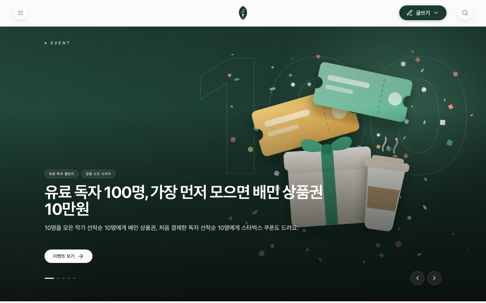
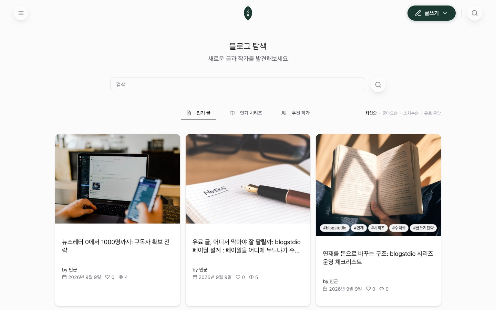
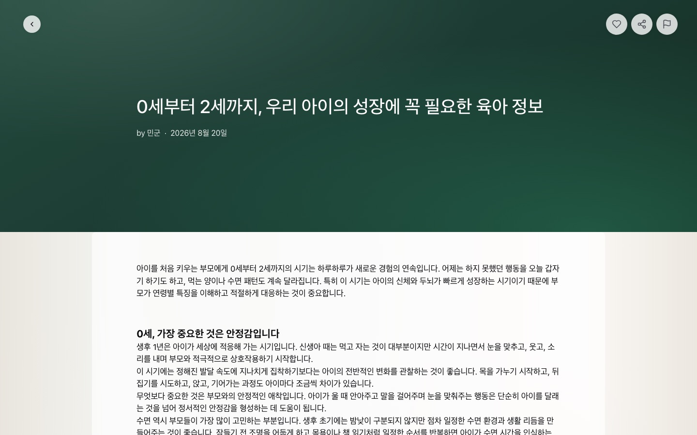
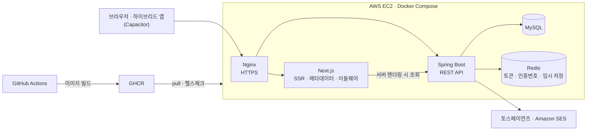

# blogstudio

글쓰기, 시리즈 연재, 구독, 유료 판매를 한곳에서 하는 콘텐츠 플랫폼입니다.
기획부터 개발, 배포, 운영까지 혼자 맡아 실제 서비스로 운영하고 있습니다. → **[blogstudio.co.kr](https://blogstudio.co.kr)**

> 이 저장소는 운영 중인 코드에서 **일부를 발췌**해 공개한 것이라 그대로 빌드·실행되지는 않습니다.
> 결제·정산·수익화 같은 핵심 비즈니스 로직과 운영 설정·배포 정보는 제외했습니다.

<p align="center">
  
  
  
</p>

## 한눈에 보기

| 항목 | 내용 |
|---|---|
| 기간 | 2025.10 ~ 현재 (운영 중) |
| 역할 | 1인 개발 — 기획, 프론트엔드, 백엔드, 인프라, 운영 |
| 규모 | 화면 81개(데스크톱 42 · 모바일 39), REST API 188개, 엔티티 32개, 커밋 415개 |
| 클라이언트 | 웹, iOS·Android 하이브리드 앱 (Capacitor) |

## 아키텍처



## 기술 스택

| 영역 | 사용 기술 |
|---|---|
| Frontend | Next.js 16 (App Router), React 19, TypeScript, Chakra UI 3, Tiptap 3, axios, Biome |
| Backend | Java 25, Spring Boot 4, Spring Data JPA, Spring Data Redis, Spring Mail |
| Data | MySQL 8, Redis |
| Infra | AWS EC2, Docker Compose, Nginx · Let's Encrypt, GitHub Actions, GHCR |
| 외부 연동 | 토스페이먼츠(빌링 결제), Amazon SES, 카카오맵 |
| App | Capacitor 7 (iOS · Android 웹뷰) |

## 핵심 사례

### 1. 검색엔진에 색인되지 않던 문제를 원인별로 해결 (SEO)

비로그인 열람을 열고 나서도 구글 검색에 사이트가 제대로 잡히지 않았습니다. Search Console과 실제 응답을 확인하며 원인을 하나씩 찾았습니다.

| 증상 | 원인 | 해결 |
|---|---|---|
| 검색 결과 설명이 "이메일 또는 휴대폰 번호. 비밀번호. 로그인" | 로그인해야 볼 수 있던 시절 크롤러가 로그인 화면만 수집 | 페이지별 제목·설명 정비, 로그인 전용 화면은 robots에서 제외 |
| Search Console "robots.txt에 의해 차단됨" — 사실상 전 페이지 | 구글봇 스마트폰 UA가 모바일로 판정돼 `/m`으로 리다이렉트, 그런데 robots가 `/m`을 막음 | 미들웨어에서 크롤러는 모바일 리다이렉트 대상에서 제외 |
| 하위 페이지가 홈의 중복본으로 처리됨 | 루트에 둔 canonical이 모든 하위 페이지로 상속 | 루트 canonical 제거, 주소가 두 갈래인 글 페이지만 직접 지정 |
| 모든 글의 제목·설명이 같고, 본문 문장으로는 검색되지 않음 | 글 페이지가 클라이언트 컴포넌트라 메타데이터·본문이 JS 실행 뒤에야 생김 | 서버 레이아웃에서 글별 메타데이터, BlogPosting JSON-LD, 서버 렌더링 본문 제공 (유료 글은 요약만) |
| 사이트맵에 글 주소가 0건, 404·리다이렉트 주소 포함 | API 경로 불일치, 목록이 없는 `/series`, 리다이렉트되는 루트 | 실제로 200을 주는 주소만 싣고, API가 실패해도 고정 경로로 사이트맵 유지 |
| 작가 페이지가 색인에서 빠짐 | robots의 `/auth`가 `/author`까지 막음 | `/auth/`로 수정 |

코드: [robots.ts](web/src/app/robots.ts) · [sitemap.ts](web/src/app/sitemap.ts) · [middleware.ts](web/src/middleware.ts) · [app/layout.tsx](web/src/app/layout.tsx) · [article/[id]/layout.tsx](web/src/app/article/%5Bid%5D/layout.tsx)
자세한 기록: [docs/seo-troubleshooting.md](docs/seo-troubleshooting.md)

### 2. 인증 — 서버가 바로 끊을 수 있는 토큰, 서버가 확인하는 이메일 인증

- **토큰**: UUID 토큰을 Redis에 14일 TTL로 저장하고, 재발급할 때 기존 토큰을 지워 교체합니다. 서버에 저장하는 토큰이라 로그아웃이나 강제 만료가 바로 반영됩니다.
- **이메일 인증번호**: SecureRandom으로 만든 6자리를 Redis에 3분 동안 두고, 번호 하나로 확인할 수 있는 횟수를 5번으로 제한합니다. 6자리는 100만 가지뿐이라 제한이 없으면 대입으로 뚫립니다.
- **가입 때 서버가 인증 여부 확인**: 인증에 성공한 주소를 Redis에 30분 남기고, 가입 API가 이를 확인한 뒤 지웁니다. 화면 상태만 믿으면 API를 직접 호출해 인증 없이 가입할 수 있기 때문입니다.
- **비밀번호**: BCrypt로 해시합니다. 72바이트를 넘는 입력은 BCrypt가 뒷부분을 무시하므로 명시적으로 거부합니다.
- **화면**: axios 인터셉터에서 401을 처리하되, 공개 페이지를 보던 비로그인 사용자는 로그인 화면으로 보내지 않습니다.

코드: [AuthController](api/src/main/java/com/blogstudio/blogstudioapi/controller/AuthController.java) · [AuthServiceImpl](api/src/main/java/com/blogstudio/blogstudioapi/service/AuthServiceImpl.java) · [VerifiedEmailStore](api/src/main/java/com/blogstudio/blogstudioapi/security/VerifiedEmailStore.java) · [PasswordHasher](api/src/main/java/com/blogstudio/blogstudioapi/security/PasswordHasher.java) · [UserServiceImpl (발췌)](api/src/main/java/com/blogstudio/blogstudioapi/service/UserServiceImpl.java) · [client.ts](web/src/lib/api/client.ts) · [auth-context.tsx](web/src/lib/api/auth-context.tsx)
테스트: [AuthServiceTest](api/src/test/java/com/blogstudio/blogstudioapi/service/AuthServiceTest.java) · [SignupEmailVerificationTest](api/src/test/java/com/blogstudio/blogstudioapi/service/SignupEmailVerificationTest.java) · [VerifiedEmailStoreTest](api/src/test/java/com/blogstudio/blogstudioapi/security/VerifiedEmailStoreTest.java)

### 3. 트랜잭션 — 롤백돼도 남아야 하는 로그

로그인 실패는 예외로 끝나서 호출한 쪽 트랜잭션이 롤백됩니다. 실패 기록까지 함께 사라지지 않도록 로그 저장은 `REQUIRES_NEW`로 별도 트랜잭션에서 커밋하고, JPA 감사(Auditing) 설정에 기대지 않도록 JdbcTemplate으로 직접 INSERT합니다. 화면에서 난 로그인 오류는 큐에 모았다가 서버로 보냅니다.

코드: [AuthErrorLogService](api/src/main/java/com/blogstudio/blogstudioapi/service/AuthErrorLogService.java) · [auth-error-queue.ts](web/src/lib/api/auth-error-queue.ts)

### 4. 동시성 — 같은 사람의 조회는 하루 한 번만

조회 기록 테이블에 (글, 조회자, 날짜) 유니크 제약을 두어, 동시에 들어온 중복 요청은 INSERT 단계에서 걸러냅니다(`DataIntegrityViolationException`). 조회수는 엔티티를 읽어 더하지 않고 `UPDATE ... SET viewCount = viewCount + 1` 한 문장으로 올려 갱신 손실이 없습니다. 검색엔진용 메타데이터를 만들려고 글을 읽을 때는 조회수를 올리지 않습니다.

코드: [ArticleViewServiceImpl](api/src/main/java/com/blogstudio/blogstudioapi/service/ArticleViewServiceImpl.java) · [ArticleDailyView](api/src/main/java/com/blogstudio/blogstudioapi/entity/ArticleDailyView.java) · [ArticleRepository (발췌)](api/src/main/java/com/blogstudio/blogstudioapi/repository/ArticleRepository.java)

## 프론트엔드 코드

| 코드 | 내용 |
|---|---|
| [use-styled-confirm-dialog](web/src/hooks/use-styled-confirm-dialog.tsx) | `const ok = await confirm({ title })`처럼 Promise로 결과를 받는 확인 창 |
| [use-toss-billing-redirect](web/src/hooks/use-toss-billing-redirect.ts) | 외부 결제창(카드 등록)에서 돌아왔을 때 결과 처리를 한 번만 실행 |
| [use-prevent-vertical-scroll-on-horizontal-swipe](web/src/hooks/use-prevent-vertical-scroll-on-horizontal-swipe.ts) | 가로 슬라이더를 넘길 때 페이지가 세로로 함께 움직이지 않게, 비스듬한 세로 스크롤은 막지 않게 |
| [resizable-image-node](web/src/components/tiptap-node/resizable-image-node) | 에디터(Tiptap) 이미지 확장 — 크기 조절, 이미지를 끌어다 놓아 갤러리로 합치기, 이미지 위 스티커 |
| [AuthGuard](web/src/components/auth/AuthGuard.tsx) · [auth-routes](web/src/lib/auth-routes.ts) | 로그인이 필요한 경로 판정과 화면 보호 |

## 저장소 구성

```
web/    Next.js — SEO, 인증, 커스텀 훅, 에디터 확장
api/    Spring Boot — 인증, 트랜잭션·동시성 처리, 테스트
docs/   SEO 문제 해결 기록, 개발 과정
```

공개하지 않은 것: 결제·정산·수익화 로직, 관리자 기능, 운영 설정·배포 스크립트·데이터

## 개발 과정

월별 작업과 일하는 방식은 [docs/development-log.md](docs/development-log.md)에 정리했습니다.
